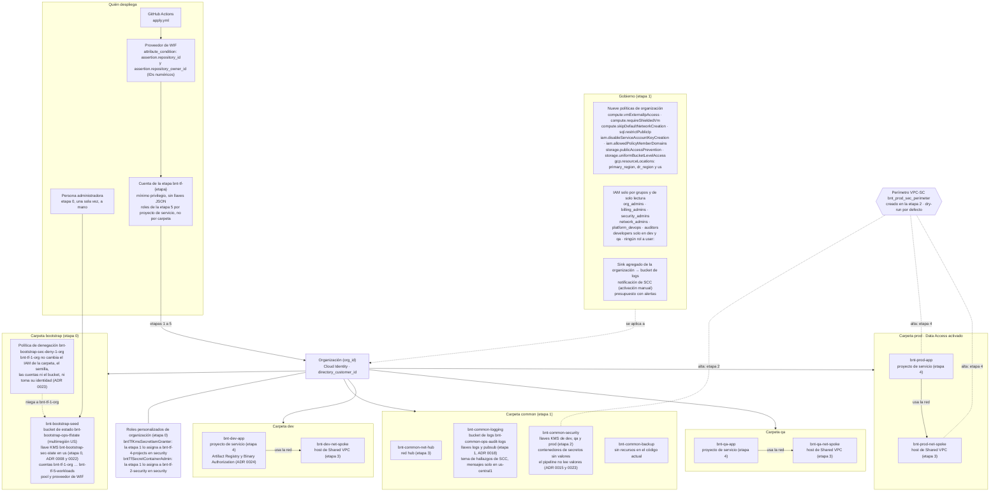

# Diagrama 1: organización, gobierno y acceso

Jerarquía de recursos con los nombres de §4.2 del contrato (ejemplo `prefix = "bnt"`), qué
etapa crea cada parte, las políticas y grupos de la etapa 1, el perímetro de VPC-SC y cómo
despliega el pipeline. Es diseño: nada se ha aplicado.

## Cómo se lee

- Cada caja de proyecto dice qué etapa lo crea o lo llena. Las carpetas de entorno tienen el
  mismo par de proyectos: el host de su Shared VPC (`net-spoke`) y un proyecto de servicio por
  aplicación (por defecto `app`).
- El perímetro de prod lo crea la etapa 2 con el proyecto `security` dentro; la etapa 4 de prod
  agrega el proyecto de servicio y el host, que VPC-SC exige en el mismo perímetro
  (ADR [0009](../adr/0009-perimetro-vpc-sc-en-dos-etapas-y-dry-run.md)).
- Hay tres llaveros fuera de la etapa 2: el del estado en el semilla (etapa 0) y el de logs y
  Pub/Sub en `logging` (etapa 1), para que haya CMEK desde el primer objeto.
- Las personas solo leen. Cambia la infraestructura el pipeline, con una cuenta por etapa y WIF
  filtrado por el ID numérico del repositorio y de su dueño (limitación: cualquier rama del
  repositorio puede usarla, ver [`pipeline.md`](../pipeline.md) §5).
- La cuenta de `1-org` tiene roles amplios de organización; la política de denegación de la
  carpeta `bootstrap` le impide usarlos sobre la base del pipeline
  (ADR [0023](../adr/0023-endurecimiento-de-la-identidad-del-pipeline.md)).

## Cambios respecto a la versión de la fase 3

- El perímetro de VPC-SC ya no rodea solo al proyecto de aplicación de prod: incluye
  `bnt-common-security` (etapa 2), `bnt-prod-app` y `bnt-prod-net-spoke` (etapa 4), y arranca en
  dry-run.
- La llave del bucket de estado se crea en la etapa 0 dentro del proyecto semilla, y la del
  bucket de logs en la etapa 1 dentro de `bnt-common-logging`; antes todo KMS aparecía en
  `bnt-common-security`.
- Security Command Center ya no aparece en `bnt-common-security`: su notificación publica en un
  tema del proyecto `bnt-common-logging`, y la activación de SCC es un paso manual.
- `bnt-common-backup` existe pero no tiene recursos: la bóveda de Backup and DR vive en el
  proyecto de servicio de cada entorno.
- Las políticas de organización son las nueve, no cuatro, y `gcp.resourceLocations` admite
  además la multirregión `us` (llaveros y bucket de doble región).
- Los grupos son siete (se agrega `billing_admins`); sus correos llegan por la variable `groups`
  en lugar de nombres fijos.
- Se quita "salvo emergencia e IAP": no hay acceso de emergencia construido y ningún grupo
  recibe permiso de IAP ([pendientes](../pendientes-apply.md), §5).
- Se agregan el rol personalizado de organización que crea la etapa 0 para la cuenta de la etapa
  4, el sink agregado, el Data Access de la carpeta prod y el presupuesto.
- Ronda de correcciones del 21 nov 2026: el rol de la etapa 4 sobre `security` lo asigna la
  etapa 1 (no la 2); se agrega el rol personalizado de contenedores de secretos de la etapa 2, la
  política de denegación de la carpeta `bootstrap`, el estado en la multirregión `US`, WIF por
  `assertion.repository_id`, y Artifact Registry con Binary Authorization en los proyectos de
  servicio.
