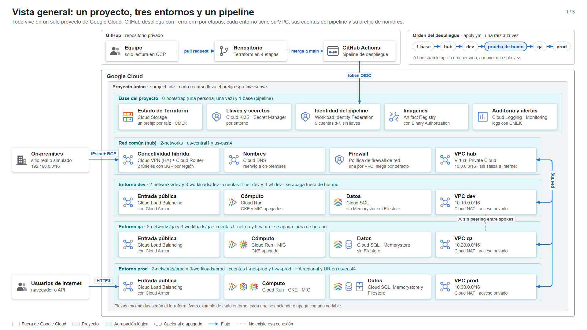
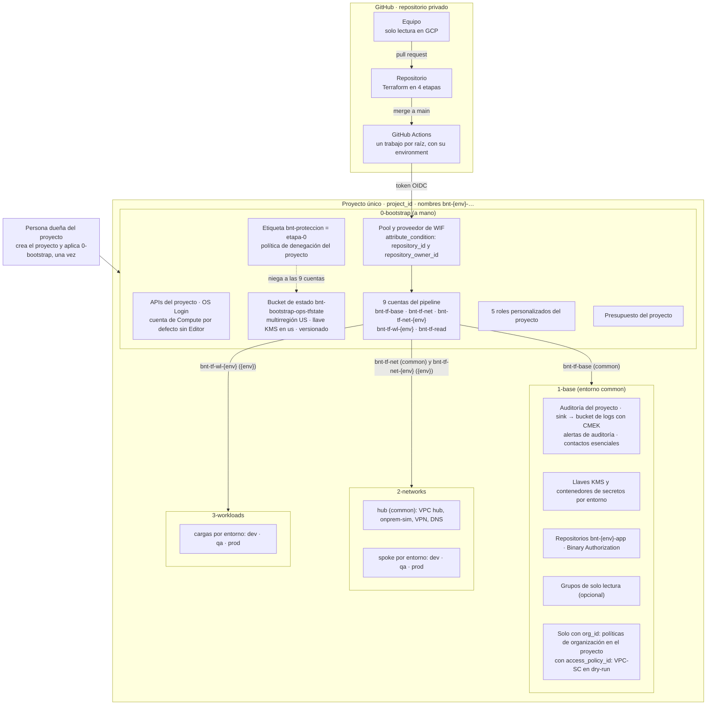

# Diagrama 1: vista general, gobierno y acceso

Todo vive en un solo proyecto de Google Cloud ([ADR 0029](../adr/0029-un-solo-proyecto.md)).
Este diagrama muestra quién crea qué, cómo entra el pipeline y qué separa a los entornos. Es
diseño: nada se ha aplicado.

El PNG sale de [`fuente/`](fuente/LEEME.md). Las piezas de cada entorno son las que enciende su
`terraform.tfvars.example`. El diagrama de texto usa `prefix = "bnt"` y `{env}` por dev, qa o
prod.

## Cómo se lee

- **Quién crea qué.** Una persona crea el proyecto (consola o `gcloud`), lo liga a una cuenta de
  facturación de pago y aplica `0-bootstrap` a mano una sola vez
  ([runbook 01](../runbooks/01-arranque-etapa-0.md)). Desde `1-base`, todo lo aplica el pipeline
  con una cuenta por raíz. Ninguna raíz crea ni borra el proyecto.
- **Raíces y cuentas** (`stages/0-bootstrap/README.md`):

  | Raíz | Prefijo del estado | Cuenta | Entorno de GitHub |
  |---|---|---|---|
  | `stages/0-bootstrap` | `0-bootstrap` | una persona | — |
  | `stages/1-base` | `1-base` | `<prefix>-tf-base` | `common` |
  | `stages/2-networks` (hub) | `2-networks/hub` | `<prefix>-tf-net` | `common` |
  | `stages/2-networks/envs/<env>` | `2-networks/<env>` | `<prefix>-tf-net-<env>` | `<env>` |
  | `stages/3-workloads/envs/<env>` | `3-workloads/<env>` | `<prefix>-tf-wl-<env>` | `<env>` |
  | plan, drift, prueba de humo, huérfanos | lee todo el bucket | `<prefix>-tf-read` | cualquiera |

- **WIF.** El proveedor acepta solo tokens del repositorio por su ID numérico y el de su dueño.
  `tf-base` y `tf-net` solo aceptan tokens del entorno `common`; cada cuenta de entorno, solo los
  de su entorno. Un trabajo sin entorno de GitHub solo obtiene `tf-read`. Cualquier rama del
  repositorio puede pedir un token (limitación de [`pipeline.md`](../pipeline.md) §5).
- **Protección del estado.** La política de denegación del proyecto niega a las nueve cuentas,
  sobre lo que tenga la etiqueta (bucket y llavero del estado, las propias cuentas), borrar o
  cambiar su IAM y suplantar a las cuentas. Sin condición les niega tocar WIF y los roles
  personalizados, crear llaves de cuentas y borrar el proyecto. Que las etiquetas funcionen sin
  organización es HYPOTHESIS (ADR 0029 §5).
- **Gobierno sin organización.** Las políticas de organización y el perímetro de VPC-SC solo se
  crean con `org_id` (y `access_policy_id`). Sin organización no existen: los cubren las reglas
  de Conftest en cada PR y los pasos manuales del runbook 01. Que no se puedan usar sin
  organización es HYPOTHESIS (ADR 0029 §1).
- **Personas.** Solo lectura por grupos (`readers`, `security_admins`, `auditors` de `1-base`,
  opcionales). La excepción es la persona dueña del proyecto, que necesita `owner` para
  `0-bootstrap`.
- **Qué separa a los entornos** (ADR 0029 §9): una VPC por entorno sin peering entre ellas, el
  prefijo `<prefix>-<env>-` y la etiqueta `env`, una cuenta por entorno ligada a su entorno de
  GitHub y permisos condicionados en Storage, KMS y Secret Manager. **No** los separan, como
  riesgo aceptado: los permisos de Compute, GKE, Cloud Run, Cloud SQL, Memorystore y Filestore
  de las cuentas de entorno, los agentes de servicio, la regla por defecto de Binary
  Authorization y las cuotas.

## Diferencias entre el código y el ADR 0029

El diagrama sigue al código (`61b01b9`). Donde el ADR dice otra cosa:

| Tema | ADR 0029 | Código |
|---|---|---|
| Cuenta de Compute por defecto sin Editor (`DEPRIVILEGE`) | En `1-base` (§4) | En `0-bootstrap` (`main.tf`) |
| Rol `<prefix>OffHoursScheduler` | En `1-base` (§4) | Lo crea `0-bootstrap`; `1-base` lo publica como `off_hours_role_id` |
| Lo que leen las raíces de red | `1-base` (y el hub, los spokes) (§2) | Ninguna lee `1-base`; los spokes leen solo el hub |
| Roles de `tf-read` | Cuatro roles más el bucket (§3) | Los mismos y `serviceusage.serviceUsageConsumer`, que tienen todas las cuentas |
| Regla sin condición de la denegación | WIF (§5) | WIF, roles personalizados, llaves de cuentas y borrar el proyecto |

El diseño anterior, de varios proyectos y carpetas, está en la rama `archivo/multiproyecto`.
