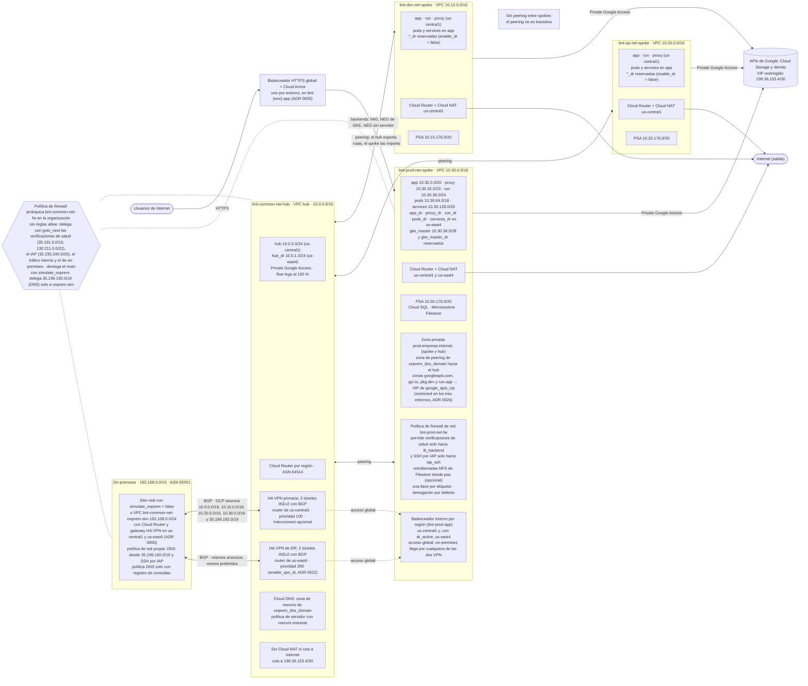

# Diagrama 2: red y conectividad

Hub y spokes con el plan de direccionamiento de §5 del contrato (X = 10 dev, 20 qa, 30 prod),
conectividad híbrida, DNS, salida a internet y acceso a las APIs de Google. Es diseño: nada se
ha aplicado.

## Cómo se lee

- Cada entorno tiene su propia VPC en su proyecto `net-spoke`, host de Shared VPC de sus
  proyectos de servicio, unida al hub por peering en los dos sentidos
  (ADR [0003](../adr/0003-vpc-por-entorno-unida-al-hub-por-peering.md)). dev y qa repiten la
  forma de prod con su X y sin las subredes de DR.
- On-premises entra solo por el hub: dos HA VPN con dos túneles y BGP cada una, una por
  región; la de DR anuncia lo mismo con prioridad 200 para que on-premises prefiera la primaria
  mientras exista (ADR [0022](../adr/0022-estado-y-conmutacion-sin-depender-de-la-region-primaria.md)).
  El hub anuncia su /16, el /16 de cada spoke y el rango de reenvío de Cloud DNS. Las rutas
  aprendidas llegan a los spokes por el peering (pendiente 6). Las IP del rango `psa` y el plano
  de control de GKE están detrás de otro peering y no se alcanzan desde on-premises.
- El balanceador interno es uno por región, con acceso global: on-premises llega al de DR
  también por la VPN primaria (pendiente 44).
- La salida a internet es por el Cloud NAT de cada spoke y región: un NAT del hub no serviría a
  VPC unidas por peering (ADR [0004](../adr/0004-cloud-nat-en-cada-spoke.md)). Hay cuatro
  gateways con el plan actual.
- Cloud Storage y las demás APIs se alcanzan por Private Google Access y el VIP de
  `google_apis_vip` (restringido por defecto; zonas `googleapis.com`, `gcr.io`, `pkg.dev` y
  `run.app` y ruta en cada spoke), no por Private Service Access
  (ADR [0026](../adr/0026-api-de-google-por-el-vip-restringido-en-todos-los-entornos.md)).
- El balanceador externo y Cloud Armor viven en el proyecto de servicio de cada entorno; el
  diagrama dibuja solo el de prod.

## Cambios respecto a la versión de la fase 3

- El balanceador HTTPS global y Cloud Armor quedan en el proyecto de servicio de cada entorno
  (antes "ubicación por confirmar").
- Se confirma una VPC por entorno unida al hub por peering, cada una host de su Shared VPC.
- El hub no tiene reglas de firewall de VPC propias. La política jerárquica de la organización
  no tiene ninguna regla allow (una allow ahí es final y dejaría sin efecto las etiquetas del
  spoke): delega con `goto_next` las verificaciones de salud (`delegate-health-checks`), el IAP
  (`delegate-iap`), el tráfico interno y el de on-premises a la política de red de cada spoke, y
  deniega lo demás. El spoke los permite por etiqueta segura: `allow-lb-health-checks` solo
  hacia `lb_backend` y `allow-iap-ssh` (TCP 22) solo hacia `iap_ssh`.
- Cloud NAT se dibuja por spoke y región (uno en dev, uno en qa, dos en prod) y el hub queda sin
  salida a internet.
- On-premises puede ser el simulado `onprem-sim`; el hub anuncia también `35.199.192.0/19`.
- Las subredes incluyen `run`, las `*_dr` de prod y los rangos reservados del plano de control;
  el rango `psa` es para Cloud SQL, Memorystore y Filestore (antes solo Cloud SQL).
- Se agregan las zonas DNS del spoke: la privada del entorno, adjunta también a la VPC hub; la de
  peering hacia el hub para el dominio on-premises; y `googleapis.com` hacia el VIP restringido.
- La política de red de cada spoke usa dos etiquetas seguras con una llave propia cada una
  (`lb_backend`, `iap_ssh`).
- Ronda de correcciones del 21 nov 2026: segunda HA VPN en la región de DR (y router de DR en
  `onprem-sim`); política de red de `onprem-sim` y delegación del rango de DNS solo hacia ella,
  para probar el reenvío en modo simulado; zonas `gcr.io`, `pkg.dev` y `run.app` hacia el VIP;
  balanceador interno por región con acceso global; regla opcional de retrollamadas NFS de
  Filestore.
