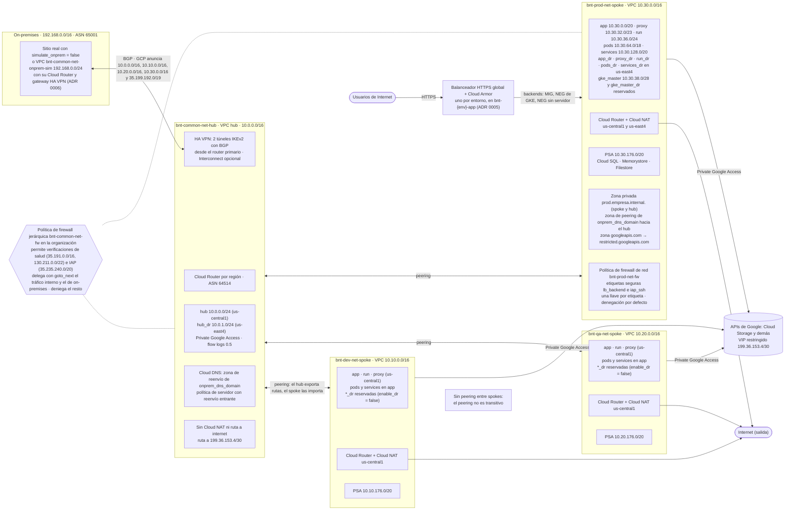

# Diagrama 2: red y conectividad

Hub y spokes con el plan de direccionamiento de §5 del contrato (X = 10 dev, 20 qa, 30 prod),
conectividad híbrida, DNS, salida a internet y acceso a las APIs de Google. Es diseño: nada se
ha aplicado.

## Cómo se lee

- Cada entorno tiene su propia VPC en su proyecto `net-spoke`, host de Shared VPC de sus
  proyectos de servicio, unida al hub por peering en los dos sentidos
  (ADR [0003](../adr/0003-vpc-por-entorno-unida-al-hub-por-peering.md)). dev y qa repiten la
  forma de prod con su X y sin las subredes de DR.
- On-premises entra solo por el hub: HA VPN con dos túneles y BGP, y el hub anuncia su /16, el
  /16 de cada spoke y el rango de reenvío de Cloud DNS. Las rutas aprendidas llegan a los spokes
  por el peering (pendiente 6). Las IP del rango `psa` y el plano de control de GKE están detrás
  de otro peering y no se alcanzan desde on-premises.
- La salida a internet es por el Cloud NAT de cada spoke y región: un NAT del hub no serviría a
  VPC unidas por peering (ADR [0004](../adr/0004-cloud-nat-en-cada-spoke.md)). Hay cuatro
  gateways con el plan actual.
- Cloud Storage y las demás APIs se alcanzan por Private Google Access y el VIP restringido
  (ruta y zona `googleapis.com` en cada spoke), no por Private Service Access.
- El balanceador externo y Cloud Armor viven en el proyecto de servicio de cada entorno; el
  diagrama dibuja solo el de prod.

## Cambios respecto a la versión de la fase 3

- El balanceador HTTPS global y Cloud Armor quedan en el proyecto de servicio de cada entorno
  (antes "ubicación por confirmar").
- Se confirma una VPC por entorno unida al hub por peering, cada una host de su Shared VPC.
- El hub no tiene reglas de firewall de VPC propias: la política jerárquica de la organización
  permite verificaciones de salud e IAP, delega el resto interno y de on-premises a la política
  de red de cada spoke y deniega lo demás.
- Cloud NAT se dibuja por spoke y región (uno en dev, uno en qa, dos en prod) y el hub queda sin
  salida a internet.
- On-premises puede ser el simulado `onprem-sim`; el hub anuncia también `35.199.192.0/19`.
- Las subredes incluyen `run`, las `*_dr` de prod y los rangos reservados del plano de control;
  el rango `psa` es para Cloud SQL, Memorystore y Filestore (antes solo Cloud SQL).
- Se agregan las zonas DNS del spoke: la privada del entorno, adjunta también a la VPC hub; la de
  peering hacia el hub para el dominio on-premises; y `googleapis.com` hacia el VIP restringido.
- La política de red de cada spoke usa dos etiquetas seguras con una llave propia cada una
  (`lb_backend`, `iap_ssh`).
