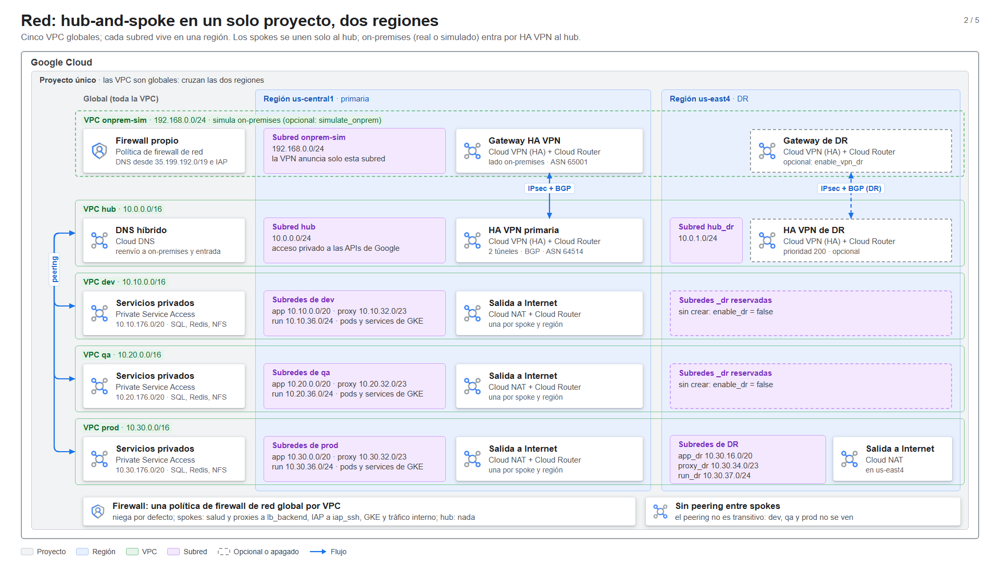
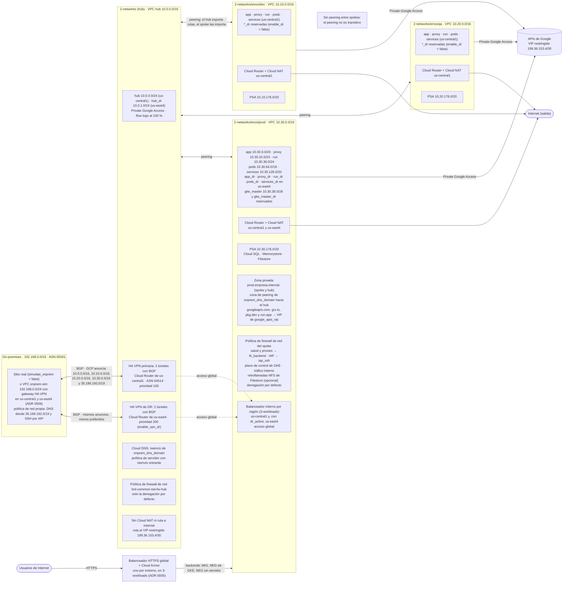

# Diagrama 2: red y conectividad

Hub y spokes en el proyecto único, con el plan de direccionamiento de §5 del contrato (X = 10
dev, 20 qa, 30 prod), la conectividad híbrida, el DNS, la salida a internet y el acceso a las APIs
de Google. Es diseño: nada se ha aplicado.

El PNG sale de [`fuente/`](fuente/LEEME.md). Los rangos son los de los
`terraform.tfvars.example` de `stages/2-networks` y `stages/2-networks/envs/<env>`. El diagrama
de texto usa `prefix = "bnt"`.

## Cómo se lee

- **Cinco VPC en un proyecto.** Hub, `dev`, `qa`, `prod` y, con `simulate_onprem = true`,
  `onprem-sim`. Sin Shared VPC: cada spoke y sus cargas viven en el mismo proyecto (ADR 0029 §6).
  Cada spoke se une al hub por peering en los dos sentidos
  (ADR [0003](../adr/0003-vpc-por-entorno-unida-al-hub-por-peering.md)); los spokes no se unen
  entre sí. Los spokes se aplican de uno en uno: GCP no admite dos operaciones de peering a la
  vez sobre la misma red (comentario de `stages/2-networks/envs/dev/main.tf`).
- **On-premises entra solo por el hub.** Dos HA VPN con dos túneles y BGP cada una, una por
  región. La de DR anuncia lo mismo con prioridad 200, para que on-premises prefiera la primaria
  (ADR [0022](../adr/0022-estado-y-conmutacion-sin-depender-de-la-region-primaria.md)). El hub
  anuncia su /16, el /16 de cada spoke y el rango del reenvío de Cloud DNS. Las rutas aprendidas
  llegan a los spokes por el peering (pendiente 6).
- **Firewall.** Sin organización no hay política jerárquica. Cada VPC tiene su propia política de
  firewall de red global con denegación por defecto (prioridad 65000, con registro):
  - hub: solo la denegación; no tiene cargas. Que la VPN y el reenvío DNS entrante no dependan de
    sus reglas es HYPOTHESIS (`VERIFICAR-EN-APPLY` en `stages/2-networks/firewall.tf`);
  - `onprem-sim`: DNS desde `35.199.192.0/19` (TCP y UDP 53) y SSH por IAP;
  - cada spoke: verificaciones de salud y proxies hacia la etiqueta segura `lb_backend`, SSH por
    IAP hacia `iap_ssh`, plano de control de GKE hacia los nodos, tráfico interno de las cargas
    y, con `enable_filestore_nfs_lock_callbacks`, las retrollamadas NFS desde el rango `psa`.
  Las etiquetas seguras tienen como padre el proyecto; que funcionen sin organización es
  HYPOTHESIS (ADR 0029 §6).
- **Salida a internet.** Por el Cloud NAT de cada spoke y región activa: uno en dev, uno en qa y
  dos en prod (prod tiene `enable_dr = true`). El hub no tiene salida
  (ADR [0004](../adr/0004-cloud-nat-en-cada-spoke.md)).
- **APIs de Google.** Por Private Google Access y el VIP de `google_apis_vip` (restringido en los
  tres ejemplos), con zonas privadas `googleapis.com`, `gcr.io`, `pkg.dev` y `run.app` en cada
  spoke (ADR [0026](../adr/0026-api-de-google-por-el-vip-restringido-en-todos-los-entornos.md)).
- **DNS.** El hub reenvía el dominio on-premises por la VPN y acepta consultas entrantes. Cada
  spoke tiene su zona privada `<env>.empresa.internal.`, adjunta también a la VPC hub para que
  on-premises la resuelva, y una zona de peering hacia el hub para el dominio on-premises.
- **Private Service Access por spoke.** Cloud SQL, Memorystore y Filestore toman IP del rango
  `psa` de su spoke. Esas IP y el plano de control de GKE están detrás de otro peering y no se
  alcanzan desde on-premises.
- **Balanceador interno de prod.** Uno por región, con acceso global: on-premises llega al de DR
  también por la VPN primaria (pendiente 44).

El diseño anterior, de varios proyectos y Shared VPC, está en la rama `archivo/multiproyecto`.
