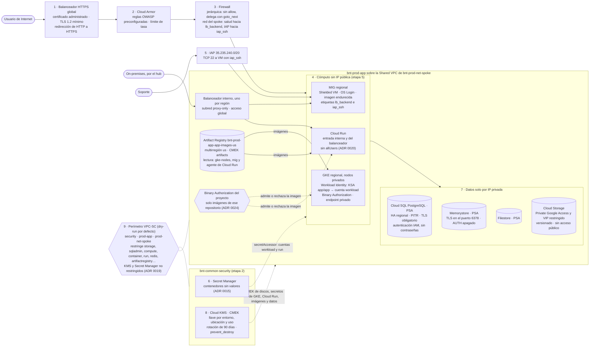

# Diagrama 3: aplicación y protección de datos

Camino de una solicitud hasta los datos de prod y los controles que encuentra, con lo que crean
las etapas 2, 4 y 5. Es diseño: nada se ha aplicado.

## Cómo se lee

- La solicitud pública entra por el balanceador externo (1) y Cloud Armor (2), los dos en el
  proyecto de servicio. El firewall (3) tiene dos niveles: la política jerárquica de la
  organización no permite nada, solo delega con `goto_next` (verificaciones de salud, IAP,
  tráfico interno y de on-premises) y deniega lo demás; la política de red del spoke es la que
  permite: verificaciones de salud y proxies solo hacia `lb_backend`, SSH por IAP solo hacia
  `iap_ssh`, y plano de control de GKE y tráfico interno de las cargas por rango.
- El cómputo (4) no tiene IP pública. Cloud Run solo acepta tráfico interno y del balanceador;
  con `public_via_load_balancer = true` desactiva la verificación de invocador en lugar de dar
  `allUsers`.
- On-premises llega por el hub al balanceador interno (subred proxy-only), no a las VM. Hay uno
  por región con cómputo y con acceso global: con `dr_active`, el de DR se agrega sin tocar el
  primario.
- Las imágenes de Cloud Run y GKE salen del repositorio multirregional de la aplicación, y la
  política de Binary Authorization del proyecto rechaza las de otro registro (ADR
  [0024](../adr/0024-artifact-registry-y-binary-authorization-por-proyecto.md)).
- Secret Manager (6) guarda contenedores; los valores se cargan fuera de Terraform. Cloud SQL no
  usa contraseñas: las cuentas `workload` (pods de GKE por Workload Identity), `run` y `mig`
  entran por IAM según el cómputo encendido (ADR
  [0015](../adr/0015-sin-contrasenas-ni-valores-de-secretos-en-terraform.md)).
- Cloud SQL, Memorystore y Filestore usan Private Service Access; Cloud Storage, Private Google
  Access con el VIP restringido (7).
- Las llaves (8) y los secretos viven en `security`, dentro del perímetro (9); KMS y Secret
  Manager no son servicios restringidos porque ese proyecto también sirve a dev y qa.

## Cambios respecto a la versión de la fase 3

- Cloud Storage se alcanza por Private Google Access y el VIP restringido
  (`restricted.googleapis.com`, 199.36.153.4/30), no por Private Service Access.
- Cloud KMS y Secret Manager quedan **dentro** del perímetro (el proyecto `security` es su
  primer miembro), no fuera; KMS y Secret Manager no se restringen (ADR 0019).
- Secret Manager ya no guarda "credenciales de BD": Cloud SQL usa autenticación IAM y los
  secretos son contenedores sin valores.
- El perímetro incluye también el proyecto host de prod y arranca en dry-run.
- Cloud IDS ya no aparece como opción: no se construye ([pendientes](../pendientes-apply.md), §5).
- El firewall no es "solo LB e IAP": la política del spoke también permite la subred proxy-only,
  el plano de control de GKE y el tráfico interno de las cargas. Las verificaciones de salud y el
  IAP los permite solo la política del spoke, por etiqueta segura; la jerárquica los delega.
- Se agregan el balanceador interno para on-premises, Cloud Run sin `allUsers` y Memorystore con
  TLS y sin AUTH.
- Ronda de correcciones del 21 nov 2026: Artifact Registry y Binary Authorization por proyecto,
  enlace de Workload Identity, balanceador interno por región con acceso global y
  `artifactregistry` entre los servicios restringidos.
