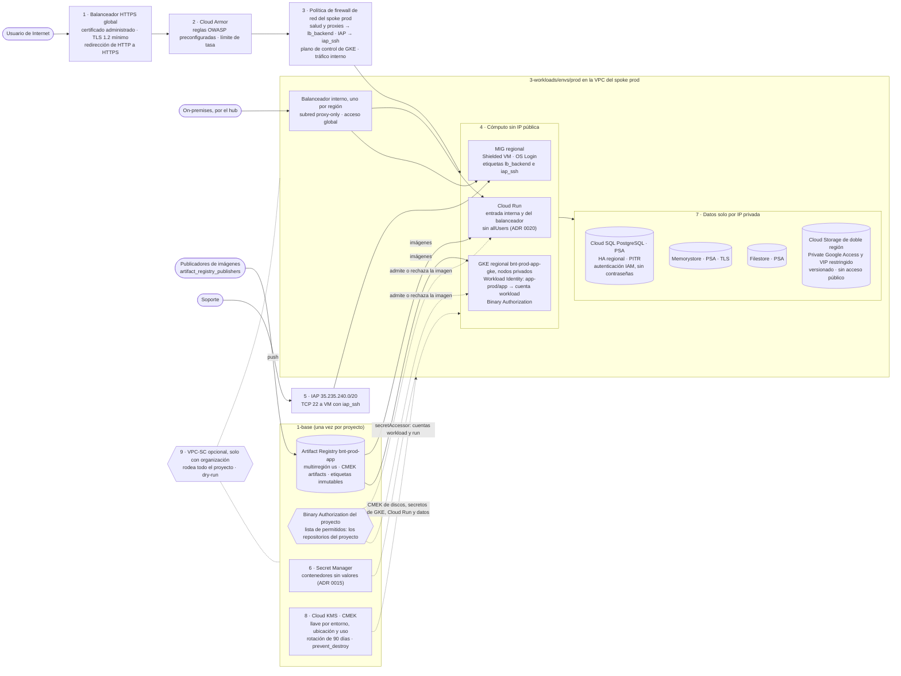

# Diagrama 3: aplicación y protección de datos

Camino de una solicitud hasta los datos de prod y los controles que encuentra. dev y qa tienen
la misma forma con menos piezas encendidas y sin DR. Es diseño: nada se ha aplicado.

El PNG sale de [`fuente/`](fuente/LEEME.md) y dibuja prod con lo que enciende
`stages/3-workloads/envs/prod/terraform.tfvars.example`. El diagrama de texto usa
`prefix = "bnt"` y la aplicación `app`.

## Cómo se lee

- **Entrada pública (1 y 2).** El balanceador externo y Cloud Armor viven en la raíz de cargas
  del entorno (ADR [0005](../adr/0005-balanceador-y-cloud-armor-en-el-proyecto-de-servicio.md),
  ajustado por el ADR 0029). Cloud Armor es una política del servicio de backend; el dibujo la
  pone antes del balanceador para leerlo de izquierda a derecha.
- **Firewall (3).** Una sola política, la de red del spoke. Permite solo hacia donde hace falta,
  por etiqueta segura o por rango, y niega lo demás ([diagrama 2](02-red-y-conectividad.md)).
- **Cómputo (4).** Sin IP pública. Cloud Run acepta tráfico interno y del balanceador; con
  `public_via_load_balancer = true` desactiva la verificación de invocador en lugar de dar
  `allUsers`. On-premises llega por el hub al balanceador interno, no a las VM.
- **Workload Identity.** El pool `<proyecto>.svc.id.goog` es el mismo para los tres entornos. Por
  eso el namespace por defecto es `<app>-<env>` y la raíz rechaza uno que no termine en `-<env>`
  (ADR 0029 §9). La cuenta de Kubernetes por defecto es `app`.
- **Imágenes.** Un repositorio por entorno y aplicación (`<prefix>-<env>-<app>`, multirregión
  `us`) y una sola política de Binary Authorization, las dos en `1-base`. Solo escriben los
  `artifact_registry_publishers` (`serviceAccount:`, `group:` o `principal…`, nunca `user:`).
- **Secretos (6) y datos (7).** Secret Manager guarda contenedores; los valores se cargan fuera
  de Terraform. Cloud SQL no usa contraseñas: las cuentas `workload` (GKE), `run` y `mig` entran
  por IAM según el cómputo encendido
  (ADR [0015](../adr/0015-sin-contrasenas-ni-valores-de-secretos-en-terraform.md)). Cloud SQL,
  Memorystore y Filestore usan el Private Service Access del spoke; Cloud Storage, Private Google
  Access con el VIP restringido.
- **Llaves (8).** Llaveros `<prefix>-<env>-sec-keyring-{usc1,use4,us}` en `1-base`. Las cuentas de
  cargas solo dan IAM sobre los llaveros y secretos de su entorno (condición por nombre). Los
  agentes de servicio son uno por proyecto y tienen permiso sobre las llaves de los tres entornos
  (riesgo aceptado, ADR 0029 §4).
- **VPC-SC (9).** Solo con `org_id` y `access_policy_id`. Rodea todo el proyecto y queda en
  dry-run: no separa entornos (ADR 0029 §1).

## Diferencias entre el código y el ADR 0029

- **Binary Authorization.** El ADR pide que cada clúster de prod solo admita el repositorio de
  prod. En el código la lista de permitidos es global, y una imagen que coincide con ella se
  admite sin importar las reglas por clúster (comentario de `stages/1-base/artifacts.tf`). Las
  reglas de los clústeres de prod existen, pero sin atestadores (`binary_authorization_attestors`)
  admiten las imágenes de cualquier repositorio del proyecto. HYPOTHESIS hasta el primer apply
  (pendiente 42).

El diseño anterior, con proyectos de servicio y Shared VPC, está en la rama
`archivo/multiproyecto`.
