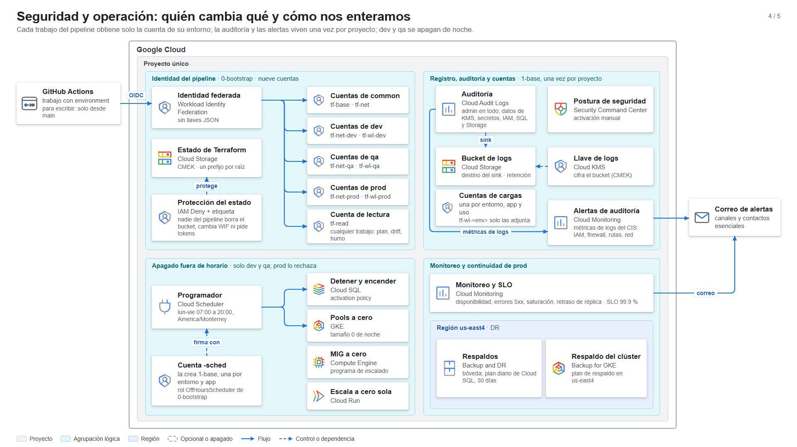
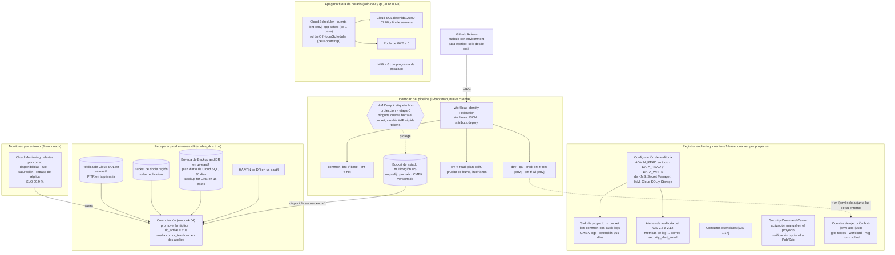

# Diagrama 4: seguridad, operación y continuidad

Quién puede cambiar qué, cómo nos enteramos de un cambio o una falla, cómo se apagan dev y qa
de noche y cómo se recupera prod en `us-east4`. Es diseño: nada ha corrido contra GCP y los
objetivos de RPO y RTO no se han medido. El pipeline tiene su propio
[diagrama 5](05-pipeline.md).

El PNG sale de [`fuente/`](fuente/LEEME.md). El diagrama de texto usa `prefix = "bnt"`.

## Cómo se lee

- **Identidad.** Nueve cuentas del pipeline, todas de `0-bootstrap`. Un trabajo de GitHub
  Actions obtiene una cuenta que escribe solo si es de `main`, de un flujo de
  `.github/workflows/` del repositorio y con el entorno de GitHub de esa cuenta
  (`attribute.deploy`); cualquier otro obtiene `tf-read`. Las cuentas de ejecución de las cargas
  las crea `1-base`, y `tf-wl-<env>` solo puede adjuntar las de su entorno. Las personas solo
  leen ([diagrama 1](01-organizacion-gobierno-acceso.md)).
- **Protección del estado.** La política de denegación y la etiqueta (ADR 0029 §5). Si las
  etiquetas no funcionan en el proyecto (HYPOTHESIS sin organización),
  `enable_protection_tags = false` deja solo la regla sin condición, y la protección queda en
  que ninguna cuenta tiene `storage.admin` ni `projectIamAdmin` sin condición
  (`stages/0-bootstrap/README.md`).
- **Auditoría (ADR 0029 §7).** La configuración de auditoría es única por proyecto, así que los
  registros de acceso a datos valen para los tres entornos. Un sink de proyecto los copia al
  bucket de logs con CMEK; una exclusión evita que el sink exporte los accesos al propio bucket.
  Las alertas de auditoría existen una sola vez, en `1-base`.
- **SCC.** Se activa a mano en el proyecto ([runbook 01](../runbooks/01-arranque-etapa-0.md)).
  La notificación a Pub/Sub de `1-base` está apagada por defecto
  (`enable_scc_notification = false`). Que SCC funcione sin organización es HYPOTHESIS.
- **Apagado fuera de horario.** Solo dev y qa (prod lo rechaza). Cloud SQL y los pools de GKE con
  trabajos de Cloud Scheduler; el MIG con un programa de escalado; Cloud Run ya escala a cero.
  La cuenta `sched` la crea `1-base` en los entornos de `off_hours_environments` y le da el rol
  del apagado, que crea `0-bootstrap`. El rol no tiene condición: la cuenta de dev podría detener
  recursos de otro entorno; los trabajos solo apuntan a los del suyo
  (`stages/1-base/runtime_accounts.tf`).
- **Monitoreo.** Uno por entorno, limitado a los recursos del entorno por nombre y etiqueta.
  También avisa al canal de operaciones de `1-base` (`operations_alert_email`), si existe; el
  canal de seguridad queda solo para las alertas de auditoría.
- **Continuidad de prod.** Datos replicados (Cloud SQL y el bucket), respaldos en la región de
  DR, la VPN de DR y el estado multirregional. La conmutación es manual, con el
  [runbook 04](../runbooks/04-conmutacion-a-dr.md). Memorystore y Filestore no tienen DR.

## Lo que cambió del primer texto del ADR 0029 al código

- El rol `<prefix>OffHoursScheduler` lo crea `0-bootstrap`, no `1-base`; `1-base` lo publica
  (`off_hours_role_id`) y se lo da a la cuenta `sched`.
- Las cuentas de ejecución, `sched` incluida, las crea `1-base`, no cada raíz de entorno.
- Las cuentas que escriben se toman por `attribute.deploy`, no por `attribute.environment`. La
  tabla completa está en el [diagrama 1](01-organizacion-gobierno-acceso.md).

El diseño anterior, con sink de organización y Data Access solo en prod, está en la rama
`archivo/multiproyecto`.
