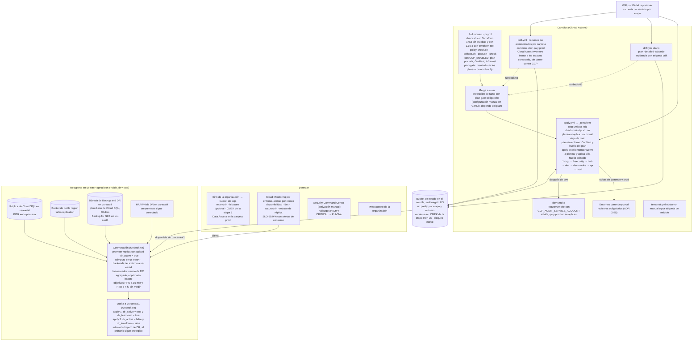

# Diagrama 4: operación, continuidad y automatización

Cómo entra un cambio, cómo se detecta una falla y cómo se recupera prod en `us-east4`. Es
diseño: ningún flujo ha corrido contra GCP y los objetivos de RPO y RTO no se han medido.

## Cómo se lee

- Todo cambio entra por PR. Sin GCP, `pr.yml` corre las revisiones estáticas, las pruebas con
  proveedores simulados, las políticas sobre los planes de ejemplo y terraform-docs; con
  `GCP_ENABLED = true` agrega el plan real, Conftest sobre él y el costo
  ([`pipeline.md`](../pipeline.md)).
- `apply.yml` aplica las raíces en serie (los spokes nunca a la vez). Cada raíz con cambios de
  `common` o `prod` espera la aprobación de su entorno, con el resumen del plan a la vista, y el
  apply solo corre si la huella del plan nuevo es igual a la revisada
  (ADR [0025](../adr/0025-plan-aprobacion-y-apply-separados.md)). Después de dev corre la prueba
  de humo; si falla, qa y prod no se aplican. La etapa 0 no está en el pipeline.
- Ni `plan-gate` ni los revisores bloquean nada hasta que alguien configure la protección de
  `main` y los entornos en GitHub, y eso depende del plan de GitHub
  ([`pipeline.md`](../pipeline.md) §4).
- `drift.yml` abre una incidencia por raíz con diferencias y, aparte, compara con Cloud Asset
  Inventory los recursos de cada carpeta de entorno con los estados; la respuesta está en el
  [runbook 05](../runbooks/05-respuesta-a-drift.md).
- La recuperación de prod combina datos replicados (Cloud SQL y el bucket), respaldos en la
  región de DR, la VPN de DR, el estado multirregional y la conmutación manual del
  [runbook 04](../runbooks/04-conmutacion-a-dr.md). Memorystore y Filestore no tienen DR.

## Cambios respecto a la versión de la fase 3

- El pull request también corre `terraform test`, `policy-check.sh` y `docs.sh --check`; el plan,
  Conftest e Infracost dependen de `GCP_ENABLED`.
- El despliegue se dibuja con el encadenado real: comunes, luego dev, qa y prod, cada raíz con
  plan, Conftest y apply del mismo plan.
- El drift diario es `plan -detailed-exitcode` con incidencia en GitHub. (Ronda de correcciones
  del 21 nov 2026: vuelve Cloud Asset Inventory, ahora construido como trabajo de recursos no
  administrados, sin correr contra GCP.)
- Las alertas van solo por correo (canales de `notification_emails`); se agregan la de retraso de
  réplica y las de consumo del SLO.
- Security Command Center se activa a mano y notifica hallazgos altos y críticos a Pub/Sub.
- La bóveda de Backup and DR vive en el proyecto de servicio, en `us-east4`, con un plan diario de
  Cloud SQL; las VM del MIG no se respaldan porque se recrean desde la plantilla.
- La conmutación ya no es "apply en us-east4": es promover la réplica con `gcloud` y aplicar la
  etapa 5 de prod con `dr_active = true`; RPO y RTO quedan como objetivos sin medir.
- Se agrega `terratest.yml`.
- Ronda de correcciones del 21 nov 2026: plan y apply separados con huella del plan, `common`
  protegido como `prod`, `plan-gate`, prueba de humo de dev, estado multirregional y VPN de DR en
  la recuperación.
- Rondas del 22 y 23 nov 2026: `check-main-tip.sh` detiene la ejecución si un commit posterior
  de `main` cambia `gcp-datacenter/` o `.github/workflows/`; los recursos no administrados se
  revisan por carpeta (`common`, `dev`, `qa` y `prod`); la vuelta a la región primaria se hace
  con `dr_teardown` en dos applies.
