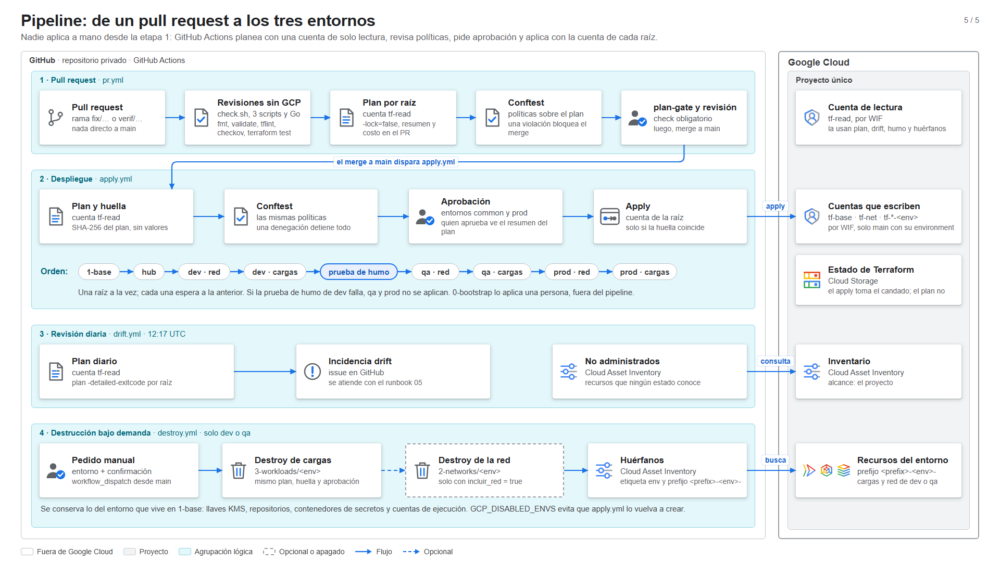
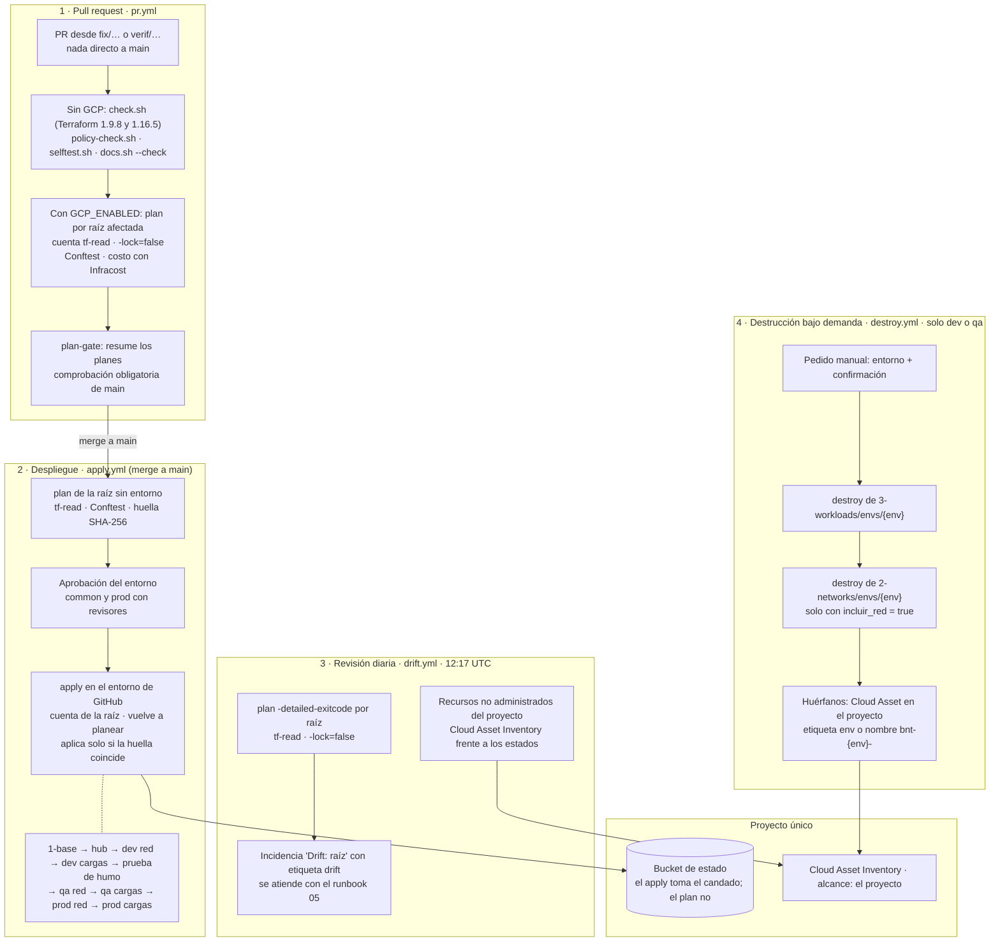

# Diagrama 5: pipeline

Cómo llega un cambio de un pull request a los tres entornos, cómo se detecta el drift y cómo se
destruye un entorno de prueba. Es diseño: ningún flujo ha corrido contra GCP.

El PNG sale de [`fuente/`](fuente/LEEME.md) y sigue a `.github/workflows/` (`pr.yml`,
`apply.yml`, `_terraform-root.yml`, `drift.yml` y `destroy.yml`).

## Cómo se lee

- **Pull request.** Sin GCP, `pr.yml` corre las revisiones estáticas, las pruebas con proveedores
  simulados, las políticas sobre planes de ejemplo y terraform-docs. Con `GCP_ENABLED = true`
  agrega el plan real de cada raíz afectada, Conftest sobre él y el costo (con el secreto
  opcional `INFRACOST_API_KEY`). `plan-gate` junta el resultado de los planes en una sola
  comprobación con nombre fijo.
- **Despliegue.** `apply.yml` corre al integrar en `main` (rutas `gcp-datacenter/**` y
  `.github/workflows/**`) o a mano. Una raíz a la vez, en el orden del ADR 0029 §2; cada flecha
  espera a que la anterior termine bien. Por raíz, un trabajo `plan` sin entorno (cuenta de
  lectura, sin candado) y, solo si hay cambios, un trabajo `apply` en el entorno de GitHub, que
  vuelve a planear con la cuenta de la raíz y aplica solo si la huella es la del plan revisado
  (ADR [0025](../adr/0025-plan-aprobacion-y-apply-separados.md)). Si la prueba de humo de dev
  falla, qa y prod no se aplican. `0-bootstrap` no está en el pipeline.
- **Aprobaciones.** Los revisores de `common` y `prod` se configuran en GitHub, no en YAML. En un
  repositorio privado dependen del plan de GitHub ([`pipeline.md`](../pipeline.md) §4,
  pendiente 12). Sin ellos, `apply.yml` aplica todo seguido.
- **Drift.** Un plan diario por raíz con la cuenta de lectura. Código 2 abre o actualiza la
  incidencia `Drift: <raíz>`, solo con direcciones y la línea `Plan:`. Un trabajo aparte busca
  recursos del proyecto que ningún estado administra
  ([runbook 05](../runbooks/05-respuesta-a-drift.md)).
- **Destroy.** Solo dev o qa, a mano y desde `main`. Destruye las cargas y, con
  `incluir_red = true`, el spoke. Queda a propósito lo del entorno que vive en `1-base`: llaves,
  repositorios y contenedores de secretos. Al final busca huérfanos en el proyecto
  (ADR 0029 §8).
- **Un solo grupo de concurrencia.** `apply.yml` y `destroy.yml` comparten
  `apply-gcp-datacenter`: nunca corren a la vez.

## Variables de GitHub que usa

Todas son variables de **repositorio**, nunca de entorno (los comentarios de
`.github/workflows/pr.yml` las describen):

| Variable | Valor |
|---|---|
| `GCP_ENABLED` | `"true"` enciende los trabajos que tocan GCP |
| `GCP_WORKLOAD_IDENTITY_PROVIDER` | salida `workload_identity_provider` de `0-bootstrap` |
| `GCP_AUDIT_SERVICE_ACCOUNT` | salida `read_service_account` (cuenta `tf-read`) |
| `GCP_STAGE_SERVICE_ACCOUNTS` | salida `stage_service_accounts` (JSON raíz → cuenta) |
| `GCP_STATE_BUCKET` | salida `state_bucket` |
| `GCP_TFVARS_JSON` | valores por raíz; `common.project_id` es obligatorio |

El diseño anterior del pipeline, con seis etapas y una cuenta de auditoría hecha a mano, está en
la rama `archivo/multiproyecto`.
